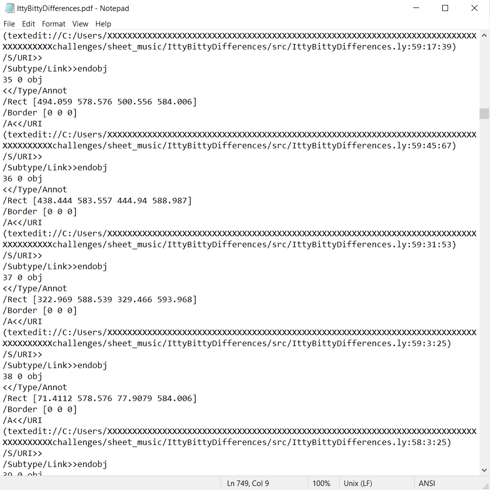

## `RedactInsideFile_Filepath+Author.py`

### Notes
* `RedactFilepathInsideFile.py` is the *deprecated* redaction file, which only redacts (from the metadata) the filepaths and *not* the author's name.
* This script works for text files and binary files, allowing 1) usage of regex and 2) printing of what was found, what was redacted, and the redacted file's complete output (with difficult-to-print characters ("difficult" according to Python's typical encoder functions at least)).
* The author-redaction regexes **do not look for specific names**. They *only* look for those two PDF metadata fields (`Author` and `creator`), so they WILL NOT redact any names that are just mentioned in plaintext throughout the file (unless those names happen to be wrapped in a PDF-metadata formatting tag for some strange reason and also somehow make it through compression into the PDF's byte data...).
  * This is desirable when you don't want to mess with the file's user-visible contents, but is undesirable when doing a mass-redaction of all names (visible or not) throughout a system.


### Process
`1)` Reads a PDF file\*, then

`2.1)` via RegEx, finds all filepaths *within the file's contents* that start with \*\*`C:/Users/` and end with \*\*`challenges/`, and  
`2.2)` via RegEx (roughly `<</Author(.*).*?>>` and `<dc:creator>(.*)</dc:creator>`), finds most human-name-related metadata *within the file's contents*, and then

`3)` replaces all those characters in between those two sentinels with \*\*garbage characters (default is char `X`).
* \*You specify either **A)** the PDF's filepath (via either console input, or by hard-coding it) or **B)** a Python `raw text`/`r` string of the PDF's raw data contents that you manually provide.
* \*\*These strings (later called 'sentinels') are configurable.
<br>

I designed this file:
* to be robust to weird usages of slashes and backslashes in a filepath, and
* to work across a few newlines (or to just tolerate a small amount of garbage whitespace) (but not too much whitespace due to Greedy RegEx over-consuming, which corrupts a PDF file, making the PDF unviewable)
* to warn the redactor/user before the script overwrites and/or corrupts any files (like if you screw up the regex while editing it).


<br>
<br>

## What's required to use this redactor
### What you *definitely* need to edit
Nothing.

### What you *may* need to edit
1) The RegEx data-finder at the top of the `stripSensitiveFilepath(...)` function, which allows you to configure your desired filepath's starting sentinel and ending sentinel.  
2) The filepath of the file you want to redact (at the bottom of the Python file).
  * You could also just provide the filepath in the console during the redactor's execution.

### What you definitely *don't* need to edit
Names to search for.  


<br>
<br>

## Examples
(Top)</i>, the plaintext string found via the regex search <i>(Bottom)</i>, and below those lines are the 4 possibly-different lengths of both the detected bytestream/string and its replacement bytestream/string, each length being on its own line while also containing the corresponding string that was used to generate that length value." src="assets/ExampleOfFilepathRedactionInsideFile.webp" width=1000 height=600>

<br>
<br>

### Example snippets of redacted file


```
/S/URI>>
/Subtype/Link>>endobj
40 0 obj
<</Type/Annot
/Rect [243.918 591.029 250.414 596.459]
/Border [0 0 0]
/A<</URI(textedit://C:/Users/XXXXXXXXXXXXXXXXXXXXXXXXXXXXXXXXXXXXXXXXXXXXXXXXXXXXXXXXXXXXXXXXXXXXXXXXXXXXXXXXXXXXchallenges/sheet_music/IttyBittyDifferences/dist/IttyBittyDifferences.ly:58:45:67)
/S/URI>>
/Subtype/Link>>endobj
41 0 obj
<</Type/Annot
/Rect [187.148 593.52 193.644 598.95]
/Border [0 0 0]
/A<</URI(textedit://C:/Users/XXXXXXXXXXXXXXXXXXXXXXXXXXXXXXXXXXXXXXXXXXXXXXXXXXXXXXXXXXXXXXXXXXXXXXXXXXXXXXXXXXXXchallenges/sheet_music/IttyBittyDifferences/dist/IttyBittyDifferences.ly:58:31:53)
/S/URI>>
/Subtype/Link>>endobj
42 0 obj
<</Type/Annot
/Rect [377.283 527.143 383.779 532.573]
/Border [0 0 0]
/A<</URI(textedit://C:/Users/XXXXXXXXXXXXXXXXXXXXXXXXXXXXXXXXXXXXXXXXXXXXXXXXXXXXXXXXXXXXXXXXXXXXXXXXXXXXXXXXXXXXchallenges/sheet_music/IttyBittyDifferences/dist/IttyBittyDifferences.ly:65:17:39)
/S/URI>>
/Subtype/Link>>endobj
43 0 obj
<</Type/Annot
/Rect [319.988 529.634 326.484 535.063]
/Border [0 0 0]
/A<</URI(textedit://C:/Users/XXXXXXXXXXXXXXXXXXXXXXXXXXXXXXXXXXXXXXXXXXXXXXXXXXXXXXXXXXXXXXXXXXXXXXXXXXXXXXXXXXXXchallenges/sheet_music/IttyBittyDifferences/dist/IttyBittyDifferences.ly:65:3:25)
/S/URI>>
```


<br>
<br>

## FAQ
```
Why did you replace the filepaths with trash instead of simply deleting the sensitive characters?
Now I have to learn some RegEx by reading your long comments in the file...
```  
* Because PDFs seem to be memory mapped. If a PDF's per-byte mappings are off, the LUT (Lookup Table) entries in the PDF file become misaligned, causing the PDF to load/render incorrectly, causing once-visible sections to disappear after redaction (in the best case. In the worst case, the PDF doesn't load/render at all).
